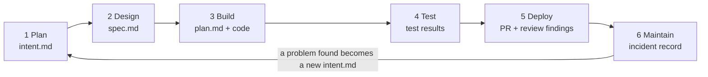

# AI-Native SDLC Playbook

A practical guide to software development in which the AI does the work and people make the decisions.

[ภาษาไทย](PLAYBOOK.md) | English

> **Source:** adapted from Anthropic's article [The AI-native SDLC playbook](https://claude.com/resources/articles/the-ai-native-sdlc-playbook) (published 21 August 2026). This document summarises the article and adjusts it to work for anyone from a single person to a large team. It is not a reproduction of the article and it is not an official Anthropic document. All examples here were written for illustration.
>
> **Companion skill:** every step in this document has a matching skill, `ai-native-sdlc` (in `.claude/skills/ai-native-sdlc/`), that lets Claude carry it out directly. See [section 12](#12-using-the-skill-with-this-playbook).

## Contents

1. [Why change how we work](#1-why-change-how-we-work)
2. [Overview: the six-stage loop](#2-overview-the-six-stage-loop)
3. [Seven principles that hold at every stage](#3-seven-principles-that-hold-at-every-stage)
4. [Who does what](#4-who-does-what)
5. [Sizing the process to the work](#5-sizing-the-process-to-the-work)
6. [Stage 1 Plan: capture the need as intent.md](#6-stage-1-plan-capture-the-need-as-intentmd)
7. [Stage 2 Design: design it as spec.md](#7-stage-2-design-design-it-as-specmd)
8. [Stage 3 Build: plan first, then build](#8-stage-3-build-plan-first-then-build)
9. [Stage 4 Test: prove it before a person looks](#9-stage-4-test-prove-it-before-a-person-looks)
10. [Stage 5 Deploy: review and approval gates](#10-stage-5-deploy-review-and-approval-gates)
11. [Stage 6 Maintain: look after it and loop back](#11-stage-6-maintain-look-after-it-and-loop-back)
12. [Using the skill with this playbook](#12-using-the-skill-with-this-playbook)
13. [Adoption plan: what to do first](#13-adoption-plan-what-to-do-first)
14. [Governance](#14-governance)
15. [Metrics](#15-metrics)
16. [Checklists](#16-checklists)
17. [Glossary](#17-glossary)

---

## 1. Why change how we work

The traditional software development lifecycle (plan, design, build, test, deploy, maintain) was designed when **writing code was the slowest step**. Requirements documents, estimation meetings and handoffs between teams existed to get everyone aligned before weeks or months of coding effort were spent.

Today AI writes code very quickly, but the steps around the code still move at human speed. Three things follow.

1. **The bottleneck moves** from writing code to deciding what to build, checking the work, and releasing it.
2. **The old controls stop working.** Rules that assume a person wrote every line cannot cope once AI writes most of the code. Either the review queue grows, or code ships without being properly checked.
3. **Governance gets more expensive** if every exception has to wait for a committee that meets once a week.

An **AI-native SDLC** redesigns each stage around what AI can do, while **keeping every one of the original control objectives** (the right people approve, changes can be traced afterwards, policy is followed). What changes is how they are enforced: checks happen at the point where the AI acts, and people spend their time where judgment is really needed.

## 2. Overview: the six-stage loop

There is one core idea: **every stage ends by committing one artifact to version control (git), and the next stage begins by reading it.** The history of those commits is the evidence of who asked, what the AI produced, and who approved.



| Stage | Question it answers | File produced | Who decides at the gate |
|---|---|---|---|
| 1 Plan | What do we want, and why? | `intent.md` | Product owner |
| 2 Design | What exactly will we build? | `spec.md` | Product owner, and a tech lead if it is risky |
| 3 Build | How will the code change? | `plan.md`, then the code and its tests | Engineer, and a tech lead if it is risky |
| 4 Test | Can we prove it works? | Test results, screenshots, eval results | Nobody has to wait: the evidence is attached automatically |
| 5 Deploy | Is it safe to merge and release? | Pull request with review findings | Code owner (merge), release manager (production) |
| 6 Maintain | Is it still healthy? | Incident record, which becomes a new `intent.md` | Service owner or on-call engineer |

### Traditional and AI-native, side by side

| Stage | Traditional | AI-native |
|---|---|---|
| Plan | Requirements gathered over several meetings and written by hand | The person with the need talks to Claude and gets an `intent.md` that people can read and the AI can act on |
| Design | An analyst writes a spec and a designer interprets it | Requirements and design are done in one working session, guided by organisational standards written as skills |
| Build | Code and tests written by hand, documentation afterwards | The AI writes code and tests; the team's knowledge lives in `CLAUDE.md` and versioned skills |
| Test | QA checks at the end of each stage | Checking runs continuously during the build, and evals test the AI's own configuration |
| Deploy | People review every line; governance happens in review cycles | Layered AI review; people check only the important and risky parts; approval gates are enforced by hooks as the AI acts |
| Maintain | People watch production | Anomaly detection watches production; when a threshold is crossed the AI diagnoses and writes a new `intent.md` |

### Where the files live

```
intent/
  2026-11-15-short-name/     one folder per change
    intent.md                Stage 1: what we want, and why
    spec.md                  Stage 2: what exactly will be built
    plan.md                  Stage 3: how the code will change
CLAUDE.md                    what a new joiner needs on day one (the AI reads it every session)
REVIEW.md                    how code is reviewed
.claude/skills/              team policies and know-how, applied automatically
.claude/agents/              specialist helpers, such as a verifier
.claude/hooks/               checks that cannot be skipped
evals/                       tests of the AI's own configuration
ops/                         production monitoring thresholds and lessons learned
```

## 3. Seven principles that hold at every stage

1. **Write it to a file before acting, and commit it.** Anything that lives only in the conversation disappears. The next stage cannot read it and nobody can audit it.
2. **Prove it, don't just say it.** "Done" means the check actually ran and its output is shown. If a test fails, fix the code, not the test.
3. **Know what is advice and what is a hard rule.** `CLAUDE.md` and skills make the AI *likely* to do the right thing. Hooks, CI and branch protection make the wrong thing *impossible*. A rule that must never be broken always needs the second layer.
4. **The author is not the approver.** Whether human or AI, whoever wrote the code cannot approve it.
5. **The same mistake twice goes into `CLAUDE.md`.** Keep that file under a page, because the AI reads all of it every time.
6. **One source of truth.** If an existing system such as Jira is already the official record, link the two both ways. Do not quietly create a second copy.
7. **Size it to the work.** A document nobody reads is cost with no control behind it.

## 4. Who does what

| Role | Part in the loop |
|---|---|
| **Product owner**, or the person with the idea | Describes the need, corrects and approves `intent.md` and `spec.md`, decides whether to go ahead. **Does not need to be able to code.** |
| **Engineer** | Reviews and approves the plan, steers the AI during the build, checks the result. The role shifts from typing code to directing several streams of work at once. |
| **Tech lead / architect** | Approves risky work, writes `REVIEW.md`, decides what a person must check. |
| **Code owner** | Approves every merge. |
| **Policy owner**, such as security, legal or brand | Owns the content of their skill and rules on concerns raised in a spec. |
| **Platform team** | Sets up hooks, permissions, CI, evals and the central settings that cannot be switched off. |
| **Release manager** | Approves releases to production. |
| **On-call engineer / service owner** | Triages what the AI finds: fix now, schedule, or dismiss. |
| **Claude (the AI)** | Does the work inside each stage, writes the artifacts, checks its own work, reviews, and **always stops at the gate.** |

If you work alone, you wear several of these hats at once. Keep the gates anyway, as moments to stop and look. Each takes under a minute, and they are the cheapest place to catch a mistake.

## 5. Sizing the process to the work

The loop exists so that **intent can be checked before code exists**. It is not a quota of documents.

| Track | Use it when | What you do |
|---|---|---|
| **Tiny** | A typo, a one-line setting, a rename. Obvious and reversible. | Make the change, check it, say what you did. No files. |
| **Small** | A bug fix, or work with a clear scope that touches a few files | A short plan, a failing test first (for bugs), the check output, a PR |
| **Full** | A new product or feature; anything that touches users, data, money or security; or anything where it is not yet clear what is wanted | `intent.md` → `spec.md` → `plan.md` → build → verify → review |

If you are unsure, take the lighter track and say why. But **move up at once** when the work turns out to be bigger than it looked. A "small fix" that slowly becomes a rebuild is work that has skipped every gate without anyone noticing.

---

## 6. Stage 1 Plan: capture the need as `intent.md`

**Goal:** the person who has the need writes it down in their own words, with Claude's help, in one sitting. No chain of handoffs in which meaning gets lost.

**Needs first:** nothing. This can be the very first thing you adopt.

**Steps**

1. **Describe the problem in your own words**, covering four things: what you cannot do today, who is affected, what "better" looks like, and what is out of scope.
2. **Talk it through until it is concrete.** Claude asks the questions an analyst would, three to five at a time, each with a suggested answer. For example: who uses this, how often, and what do they do today instead? What is the smallest version that would already be useful? What must not change or break? How would we know in a month that it worked?
3. **Claude writes `intent.md`** from the template: problem, proposed outcome, affected users and systems, constraints, out of scope, success measures, assumptions, open questions.
4. **Read it back and correct it.** Where Claude misunderstood, fixing it here takes minutes. Fixing it once code exists takes days.
5. **Commit it to the shared home**, and the product owner approves. Approval is the signal that starts Stage 2.

**Say to Claude**

> I want an appointment reminder system for our clinic. At the moment staff phone each patient to remind them. Ask me what you need to know, then write it up as intent.md.

**Quality bar**

- Someone who was not in the conversation can tell what the problem is and whose it is.
- It says **what and why, not how.** No screens, tables or technology names, unless one is a real constraint.
- At least one success measure can actually be checked.
- Unknowns are written down as open questions. They are not quietly answered.
- A number that did not come from real data is labelled as an estimate to verify.
- It is one change. If it describes three outcomes for three groups of users, split it into three files.

**Evidence produced:** the `intent.md` file with author, timestamp, revision history and the record of approval.

**Measures:** time from first conversation to committed `intent.md` (should fall to hours); share of intents that go forward; number of times the intent is changed after the spec has been started.

> People who do not use git can still do this stage. Once Claude is connected to the code host (for example GitHub), Claude commits the file for them.

## 7. Stage 2 Design: design it as `spec.md`

**Goal:** turn an approved `intent.md` into a document the team can build from, in one working session, with the organisation's policies (brand, security, legal, user experience) applied **while it is written** and not inspected at the end. The product owner reviews it. They do not have to write it.

**Needs first:** an approved `intent.md`. It helps a great deal if policies have been written as skills (see [Stage 3](#84-skills-organisational-knowledge-that-actually-gets-applied)). If none exist yet, Claude applies general good practice and says clearly that it did.

**Steps**

1. Start by having Claude read `intent.md`, the existing code, and the relevant policy skills.
2. Claude writes `spec.md`, including a "flagged concerns" section.
3. The product owner checks it against the idea: does it solve the stated problem? Has every open question been answered, or deliberately carried forward?
4. **Resolve the concerns with the policy owners first**, before the engineering team sees the document.
5. Commit `spec.md` next to `intent.md`.
6. The product owner decides whether to go ahead, consulting a tech lead if it is risky. **A person always makes this decision.**

**What a good spec contains**

- A plain-language summary of what will exist when this is done.
- **Numbered requirements** (R1, R2, ...), each a single testable statement with an acceptance check, such as "When a patient has opted out of messages, the system sends no message at all."
- The design: how it fits the existing system, what data is stored or sent, the screens and the user's steps.
- Quality needs such as speed, privacy and accessibility.
- The policies that were applied, and what each one changed in the design.
- For anything with a screen, an attached mock. The approved mock becomes a proof target in the build stage.

**Concerns that must be raised, never settled silently:** policies that contradict each other; a need that conflicts with a policy; requirements that had to be guessed; risk involving money, personal data, authentication, or anything irreversible. Each concern comes with the options and a recommendation.

**Say to Claude**

> Read the intent.md for the appointment reminders and write a spec.md that fits our existing system. Apply our security and brand policies, and tell me every point of concern, especially where policies contradict each other.

**Evidence produced:** the spec, the prompt that was used, the versions of the skills applied, the approval, and the routing of each concern to its policy owner.

**Measures:** time from intent to spec; number of times the spec is changed after building has started.

## 8. Stage 3 Build: plan first, then build

### 8.1 Plan before the first edit (`plan.md`)

**Goal:** the design review happens **before code exists**. Traditionally the engineer reads the design and starts typing. Which files to change and how to test stay in one person's head, and reviewers see only the final result.

1. Start in read-only mode (plan mode): Claude can read the code but cannot change it until the plan is approved.
2. Give it `intent.md` and `spec.md` and ask for a plan that names the files that will change, the order of work, and the tests that will prove it.
3. **Question the plan:** what could break? Which step is riskiest? Which options were rejected, and why?
4. Revise until **someone who never saw the conversation could carry out this plan**.
5. Commit the approved plan as `plan.md`.
6. Let Claude build.
7. If the build departs from the plan, update `plan.md` in the same commit.

**Measures:** share of changes that pass from the first build; time from plan approval to merge; number of rework rounds.

### 8.2 Letting the AI work without approving every edit

This suits routine work as the default **only once the guardrails are all in place**: a clear spec, a narrow impact, tests the AI can run itself, a tuned `CLAUDE.md`, and hooks protecting what must not be touched. At that point people stop watching edits one at a time and review the finished work instead.

### 8.3 `CLAUDE.md`: what a new joiner needs to know

This is the file Claude reads every time it starts work. It moves knowledge out of people's heads and wikis into one place.

- Have Claude generate a first draft (the `/init` command), then **cut it to the essentials**: the build, test and lint commands (with what healthy output looks like), the main conventions, the shape of the system, and the things Claude tends to get wrong.
- Keep it at the root of the project and review changes to it like code.
- The rule: **the same mistake twice gets written into this file.**
- No more than one page.

### 8.4 Skills: organisational knowledge that actually gets applied

A skill is a folder containing a `SKILL.md` file that says when it applies and what to do. It makes a policy apply automatically, gives it a version, and means one edit reaches everyone.

- **Write a skill when** the knowledge must be applied the same way every time, such as a security standard, an API convention or a brand rule.
- **Do not write one** if it belongs in `CLAUDE.md` or is a one-off instruction.
- Pick one policy that **has a clear owner** and a written source. Write it as a skill in `.claude/skills/<name>/`. Test that it is picked up when the task is asked for in several different ways. Have the policy owner approve every change.

> **Important:** a skill is an advisory control. It makes compliance frequent, not forced. A policy that must never be broken needs a hook, or a re-check at PR time, behind it.

### 8.5 Hooks: guardrails during the build

A hook is a script the tool runs automatically at a set point, for example before a file is edited or after a command runs.

- Block edits to files that must not be touched (generated code, frozen parts).
- Format and lint the code after every edit.
- Keep secrets out of the code.
- They must be **fast, and check only the file that changed**. Heavy checks belong at commit or PR time.
- Hooks that wait for a person's approval belong at the gates in the Deploy stage, not during the build.

### 8.6 Working several streams at once, and specialist helpers

- **Parallel sessions:** another Claude works on a different task in its own copy of the project (a git worktree). The sessions do not know about each other.
- **Subagents:** specialist helpers for repeated jobs inside one piece of work, such as a **verifier** that starts the app and tries it for real without changing anything, a **code simplifier**, and a **researcher** that explores the code and reports back.

Split the work by files that do not overlap. Start with two or three streams, and add more only while **review keeps up**. Work that has not been reviewed does not count as progress.

### 8.7 Brand-new projects

Before building the first feature, create the conditions everything else depends on: scaffold the project, make build, test and lint each run with one command, have at least one real test, and write `CLAUDE.md`. Then build the smallest piece a user could actually try.

## 9. Stage 4 Test: prove it before a person looks

Two principles: **(1) every piece of work checks itself before it reaches a person, and (2) the configuration that steers the AI is tested like code.**

### 9.1 The feedback loop

Traditionally the signals come late: CI minutes later, a tester days later, real users weeks later. If a person has to check every piece of AI output, that person becomes the bottleneck.

1. Wrap multi-step checks in one command, such as `make test`.
2. Write the commands in `CLAUDE.md` with an example of healthy output.
3. Set targets that can be measured, such as "all tests in this file pass" or "the screenshot matches the mock".
4. For screen work: build, screenshot, compare, adjust. Two or three rounds is normal.
5. State in `CLAUDE.md` that "done" includes running the checks and showing the output.
6. Use a verifier that starts with a fresh view as the final check.

### 9.2 Fixing a bug: write the failing test first

A test that existed before the fix, and that the AI was not able to edit, is the proof that the bug is gone.

1. Reproduce the bug and state the cause.
2. Write a test that **fails because of that bug**. Run it and confirm it fails for the right reason.
3. Commit that test on its own first.
4. Lock the test file (with a hook, or by rule).
5. Fix the code until the test passes **without touching the test**. If the test itself is wrong, stop and tell a person.
6. Run the whole test suite, not only the new test.
7. Report with the real output: the failing run, the passing run, and the full suite.

### 9.3 Evals: testing the AI's configuration continuously

An eval is a real task recorded together with an acceptable result. An eval suite answers the question: **"After a configuration change (a new model, an edited `CLAUDE.md`, skill or hook), does the AI still do our work to our standard?"**

1. Collect 20 to 50 real, recent tasks with their accepted results.
2. Write each as an eval: the prompt and the acceptance checks.
3. Run them automatically in CI, on a schedule and whenever the configuration changes.
4. Use the result as a gate: a change that lowers the pass rate gets looked at before it merges.
5. **Every production incident gets an eval**, kept permanently.

**Measures for this stage:** first-pass CI success rate; review time per PR; change failure rate; eval pass rate; problems caught in CI compared with those that reached production.

## 10. Stage 5 Deploy: review and approval gates

**Principle:** the AI can do everything up to the production gate, and **nothing at all past it**.

### 10.1 AI in the review loop

Claude reviews every PR against the same criteria, ranks findings by severity, and fixes review comments on its own PRs. People then spend their time on two questions: **does this do what was intended, and is the risk acceptable?**

1. Turn on AI review in the code host.
2. The tech lead writes `REVIEW.md`, defining **three passes**: (a) bugs and logic, (b) security, (c) whether it matches `spec.md`, `plan.md` and the design principles. It also defines what counts as "important" and what is a "nit", with a cap on nits (for example five).
3. Set the human threshold: AI review findings neither approve nor reject on their own. A code owner still approves every time.
4. When someone tags `@claude` in a comment, Claude fixes it and pushes the change.
5. A mistake caught a second time goes into `CLAUDE.md`.
6. Tune `REVIEW.md` every month. Reviews nobody reads are noise.

### 10.2 Hooks as approval gates

A hook can answer three ways: **allow, ask** (pause for a person's approval), or **block**.

1. Leadership and compliance write the list of "approvals that must survive", such as release sign-off and edits to important files.
2. The platform team writes each one as a hook.
3. Team hooks live in `.claude/settings.json`. Hooks that must never be switched off live in central settings controlled by an administrator.
4. **A block must explain itself:** it gives the reason and says who to go to for approval.
5. **Prove the gates work.** The skill's templates include a command, `python3 .claude/hooks/check_guardrails.py`, that tries every rule listed in `.claude/guardrail-checks.txt` and reports whether each one is allowed, asked about, or blocked. Put this command in the test suite, so that a guardrail weakened by accident is caught immediately.

> A rule stated as **"never"** should have several layers: the hook, a `permissions.deny` rule in the settings (which works even if the hook cannot run), and where possible a control outside the AI altogether, such as a CI check on the files, or not keeping production credentials on developers' machines.

### 10.3 Locked-down settings for heavily regulated organisations

| Area | Control | Reason |
|---|---|---|
| Permissions | No reading of secret files, no fetching from the web | Keeps secrets out of the AI's context |
| Pre-allowed commands | git, build, test, lint | People do not get used to clicking "OK" without reading |
| Lockdown | Bypass-permissions mode disabled | Nobody can switch the guardrails off themselves |
| Sandbox | Always on, with the network restricted at operating-system level | Closes the gap through which shell commands could reach the internet |
| Credentials | No access to SSH keys or cloud credential files | Covers the gaps that file-level rules do not see |
| Extensions | Only approved hooks, plugins and MCP servers | Prevents installing something to get around the controls |

### 10.4 CI/CD and release

Add trust one step at a time. **The gates must exist before automation speeds through them.**

1. Start with **read-only** jobs: analyse a failed build, summarise a flaky test, draft the change log.
2. Add jobs that **can write, but only behind the existing gates**: the output always arrives as a PR. The AI has no way to push straight to the main branch.
3. Run the AI in a restricted box with no production access of its own.
4. Expose deploy, status and rollback as tools limited per environment.
5. **Tier the autonomy:** development is free; staging is in between; for production the AI prepares the release but the release manager approves it.
6. **Rollback must be the most rehearsed path:** one command, practised regularly in staging.

**Measures for this stage:** time to first review (should fall to minutes); share of comments resolved without a person touching the branch; defects caught before merge compared with those that escaped; waiting time at each gate; and the DORA measures.

## 11. Stage 6 Maintain: look after it and loop back

Traditional maintenance is reactive: an alert at 3 a.m. is missed, work sits in the queue, and the lessons from an incident never reach the code. In the new approach a trigger calls Claude without a person having to start it. Claude diagnoses, acts only through gated routes, and writes what it found as an `intent.md`. People triage and review.

### 11.1 Monitoring thresholds and response tiers

1. Pick **one measure** with a stable normal level, such as the CI test failure rate or the error rate after a deployment.
2. Write the detection as **fixed logic with no AI in it**: a rolling mean and standard deviation, with rules that catch both a sudden spike and a slow drift.
3. Define the response tiers.

| Size of the anomaly | What happens | What the AI may do |
|---|---|---|
| 1 sigma | It is logged | Nothing |
| 2 sigma | Diagnosis | Read only |
| 3 sigma | Propose or act | Only open a PR into the review gate, or trigger a procedure approved in advance (such as rollback) |

4. Claude writes its diagnosis as an `intent.md` ("anomaly and evidence" in place of "problem").
5. A person triages: fix now, schedule, or dismiss. A dismissal is information for tuning the thresholds.
6. Once it is fixed, **add an eval for that incident**.

### 11.2 Scanning the code regularly

A security scan is a picture of one moment. It goes stale as the code changes, and newer models tend to find what earlier ones missed. So schedule scans (for example weekly) and let the findings go through the same gates as any other change: a small problem is fixed through a PR, a large one is written up as an `intent.md`, a dismissal needs a stated reason, and once something is fixed an eval is added.

> The source article mentions the products Claude Security (code scanning) and Claude Tag (Claude as a member of the team's chat channels, to pick up incidents). Both were in beta when the article was published. Check their current status and terms before planning to use them.

### 11.3 The post-incident record (post-mortem)

Every incident ends with a record kept in git: what happened, the impact, the cause (including why it was not caught earlier), how it was fixed, and **what changes so it does not happen again** (the test or eval that was added, the line in `CLAUDE.md`, the hook, the threshold that was tuned). Add one entry to `ops/lessons.md`, which the AI reads before starting its next investigation.

**Measures for this stage:** time from threshold breach to an `intent.md` ready for triage; share of findings that become real fixes; repeat incidents of the same kind (should fall).

---

## 12. Using the skill with this playbook

The `ai-native-sdlc` skill is in `.claude/skills/ai-native-sdlc/`. When you open this project in Claude Code the skill is ready to use. You do not need to remember commands. Just say what you want.

| You say | The skill takes you to |
|---|---|
| "I want to build an app that..." / "I need a feature for..." | Stage 1: asks until it is clear, then writes `intent.md` |
| "Write the spec" | Stage 2: writes `spec.md` with flagged concerns |
| "Go ahead and build it" / "Plan this work" | Stage 3: writes `plan.md` first, then builds |
| "Fix this bug" | Writes a failing test first, fixes it, shows the output |
| "Set this project up for working with AI" | Installs `CLAUDE.md`, the `intent/` folder, `REVIEW.md` and more |
| "Review this" / "Is this ready to ship?" | Stage 5: three review passes, findings ranked by severity |
| "The system has a problem" / "Write up the incident" | Stage 6: diagnoses, records, and writes a new `intent.md` |
| "Where has the work got to?" | Shows the status of every change and its next step |

**What is in the skill**

| Part | Contents |
|---|---|
| `SKILL.md` | The loop at a glance, how to choose where to start, the gates, and the rules that hold at every stage |
| `references/` | The detailed guide for each stage, governance, and the adoption plan with metrics |
| `assets/templates/change/` | Templates for `intent.md`, `spec.md` and `plan.md` |
| `assets/templates/repo/` | Templates for `CLAUDE.md`, `REVIEW.md`, hooks, subagents, evals, CI and monitoring thresholds |
| `scripts/sdlc.py` | A script that installs the layout, starts a new change, and shows status |

**The script's commands** (Claude runs them for you; you do not have to type them)

```bash
python .claude/skills/ai-native-sdlc/scripts/sdlc.py init . --all     # install everything (never overwrites existing files)
python .claude/skills/ai-native-sdlc/scripts/sdlc.py new . "Title of the change"
python .claude/skills/ai-native-sdlc/scripts/sdlc.py status .         # which change is at which stage
```

## 13. Adoption plan: what to do first

Each practice can be adopted on its own, but some need others in place first.

| Wave | What you do | Needs first |
|---|---|---|
| **1 Foundations** (one team, one project) | `CLAUDE.md`; one-command build, test and lint with self-checking; plan before acting; `intent.md` for new work | Nothing |
| **2 Guardrails and knowledge** | The first policy skill; hooks protecting important files and the release gate; `REVIEW.md` and AI review on every PR; `spec.md` produced from intent | Wave 1 |
| **3 Scale** | Parallel sessions and subagents; evals in CI; letting the AI work unattended on routine tasks; read-only CI jobs | `CLAUDE.md`, self-checking, review |
| **4 The autonomous loop** | CI jobs that can write behind gates; deploy tools and a rehearsed rollback; monitoring thresholds that write `intent.md`; scheduled scans | Review, approval-gate hooks, rollback |

**If you work alone or in a very small team,** Wave 1 plus `REVIEW.md` is already a complete and useful way of working. Stop there until something hurts.

**Every join between stages matures the same way**

1. **Prompt each step by hand**, to learn what a good artifact looks like.
2. **Turn it into a ready-made command** (a skill or slash command), so everyone runs it the same way.
3. **Let one step trigger the next:** approving `intent.md` starts the design; approving `spec.md` starts the planning; merging a PR starts the pipeline; a breached threshold in production writes a new `intent.md`.

Do not do step 3 until step 1 reliably produces work that people accept.

**Advice for rolling it out:** start with a willing pilot team that has a reasonable test suite; name the owners of `CLAUDE.md`, the skills, `REVIEW.md`, the hooks and the evals; **take a baseline of the measures before changing anything**; review the numbers together with sample artifacts every month; and expect the bottleneck to move (building gets faster, so the queue appears at review, then at deploy). That is the signal to start the next wave.

## 14. Governance

**Who approves what**

| Decision | Approver | Recorded as |
|---|---|---|
| Is this the right problem? (`intent.md`) | Product owner | The merge, or the `accepted_by` field |
| Is this the right solution? (`spec.md`) | Product owner, tech lead, policy owners | The same, with the resolution of each concern |
| Is this the right way to change the code? (`plan.md`) | Engineer or tech lead | The committed plan and its revision history |
| Can it merge? | Code owner | PR approval |
| Can it go to production? | Release manager, or an approved change ticket | The hook's log and the release record |
| Can the AI's configuration change? | Code owner and policy owner | PR review and the eval result |

**Two layers of control**

| Layer | Examples | Strength |
|---|---|---|
| Advisory | `CLAUDE.md`, skills, `REVIEW.md` | Makes the right thing frequent |
| Hard rule | Hooks, permission rules, sandbox, CI, branch protection | Makes the wrong thing impossible |

**Living alongside existing systems (Jira and others).** Choose one of three arrangements for each document.

1. **The repository is the source of truth.** The existing system links to the file.
2. **The existing system is the source of truth.** The markdown file is a working copy. Claude reads from the existing system at the start and writes the result back.
3. **Two-way links (the minimum).** The file states the record's ID, and the record states the git commit ID.

**The chain of evidence:** `intent.md` → `spec.md` → `plan.md` → code and tests → PR and review findings → incident record. Each is one commit in git, and together they answer an auditor's questions: who asked, what did the AI produce, and who approved.

> The loop gets you to the point of decision faster and with better evidence, but it does not make the decision for you. People remain responsible for whether the problem is worth solving, whether the solution is acceptable, whether the risk is acceptable, and whether to release.

## 15. Metrics

**Leading measures** move within weeks and show whether the practice is being followed. **Lagging measures** move within months and show whether it is working.

| Practice | Leading | Lagging |
|---|---|---|
| Intent | Time from first conversation to committed `intent.md` | Share that goes forward; intent changes after the spec starts |
| Spec | Time from intent to spec | Spec changes after building starts |
| Plan first | Share passing first time; time from plan approval to merge | Rework rounds per change; merged code still matches the plan |
| `CLAUDE.md` | Repeated mistakes | Time for a new joiner to merge their first PR |
| Skills | Time from policy approval to the skill being merged | Review findings citing that policy (should approach zero) |
| Parallel work | Streams per person while review still copes | Changes merged per person per week, read with the rework rate |
| Self-checking | First-pass CI success rate | Review time per PR; change failure rate |
| Evals | Pass rate; time from incident to a permanent eval | Problems caught in CI compared with production |
| Review | Time to first review; comments resolved without a person touching the branch | Defects caught before merge compared with those that escaped |
| Gate hooks | Waiting time at each gate | Gate violations that reached production |
| CI/CD | Share of failures analysed without calling a person | DORA: deployment frequency, lead time, failure rate, recovery time |
| Monitoring | Time from threshold breach to an `intent.md` | Findings that became real fixes; repeat incidents of the same kind |

**Always read the measures in pairs.** Speed without its quality partner (for example, changes merged without looking at the rework rate) rewards the wrong behaviour.

## 16. Checklists

**Setting up a project (once)**

- [ ] Build, test and lint each run with one command, and have actually been run
- [ ] `CLAUDE.md` is no longer than a page and has no placeholders left
- [ ] There is an `intent/` folder and it is known who approves
- [ ] There is a `REVIEW.md`, and a code owner must approve before merge
- [ ] The list of "approvals that must survive" is written down and turned into hooks
- [ ] Each configuration file has an owner
- [ ] A baseline of the measures has been taken

**For each change (Full track)**

- [ ] `intent.md`: says what and why, has a success measure, has open questions, and is approved
- [ ] `spec.md`: requirements are numbered with acceptance checks, concerns were raised and resolved, and it is approved
- [ ] `plan.md`: files to change, order of work, risks, proof, rollback, and approved before the first edit
- [ ] Check results (build, test, lint) are attached as real output
- [ ] Bug fixes: a failing test existed before the fix and was not edited along the way
- [ ] `plan.md` matches the code that was actually written
- [ ] All three review passes are done, and every important finding is fixed
- [ ] The approver is not the author
- [ ] The production release was approved by the named person, and the rollback is known

**After an incident**

- [ ] The incident record is in git
- [ ] A test or eval was added for this kind of problem
- [ ] `CLAUDE.md`, a skill, a hook or a monitoring threshold was adjusted as needed
- [ ] If the real fix is bigger than a patch, a new `intent.md` was opened

## 17. Glossary

| Term | Plain meaning |
|---|---|
| **SDLC** | The software development lifecycle, from idea to looking after it once in use |
| **Repository (repo)** | The store of all the project's files, with their history of changes |
| **git / commit** | The system that keeps the history of files / one recorded change, with who made it and when |
| **Branch** | A separate line of the code, used to work without affecting the main line |
| **Pull request (PR)** | A request to merge changes into the main line; where review and approval happen |
| **Branch protection** | A setting that requires someone's approval before code can be merged |
| **Artifact** | The file each stage produces, such as `intent.md` |
| **Gate** | A point where work stops and waits for a person to decide |
| **Build / Test / Lint** | Assemble the program / check that it works correctly / check code style and common mistakes |
| **CI/CD** | Automation that tests and releases the program every time the code changes |
| **Production / Staging** | The real system that users use / a realistic rehearsal system for testing first |
| **Deploy / Rollback** | Release a new version into use / go back to the previous version when there is a problem |
| **CLAUDE.md** | The project's instruction file, which Claude reads every time it starts work |
| **Skill** | A set of instructions and knowledge that Claude picks up by itself when it meets a matching task |
| **Hook** | A script that runs automatically before or after an action by the AI; used as a gate that cannot be skipped |
| **Plan mode** | A mode in which Claude can read and plan but cannot yet change files |
| **Subagent** | A specialist helper that Claude calls on within the same piece of work |
| **Worktree** | A second working copy of the same project, so several pieces of work can proceed without colliding |
| **Eval** | A test that measures whether the AI still works to standard after a configuration change |
| **MCP** | A standard that lets the AI connect to outside tools and systems |
| **Sandbox** | A restricted space for the AI to work in, with access only to what is allowed |
| **Code owner** | The person responsible for a part of the code, who must approve changes to it |
| **Control band / sigma** | The normal range of a measure / a unit for how far the current value is from normal |
| **DORA** | Four standard measures of software delivery: deployment frequency, lead time, failure rate, recovery time |
| **Post-mortem** | A written review after an incident: what happened, why, and how to stop it happening again |

---

*"The loop keeps running. Human judgement stays above it."* is the closing thought of the source article, and the principle this playbook holds to.
