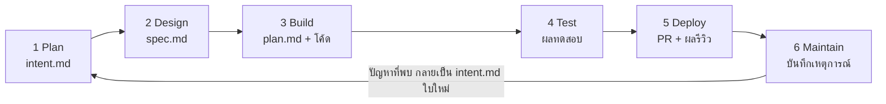

# AI-Native SDLC Playbook

คู่มือการพัฒนาซอฟต์แวร์แบบ "AI เป็นคนลงมือ คนเป็นผู้ตัดสินใจ" ฉบับใช้งานจริง

ภาษาไทย | [English](PLAYBOOK.en.md)

> **ที่มา:** เรียบเรียงจากบทความ [The AI-native SDLC playbook](https://claude.com/resources/articles/the-ai-native-sdlc-playbook) ของ Anthropic (เผยแพร่ 21 ส.ค. 2026) เอกสารนี้เป็นการสรุปและปรับให้ใช้ได้ตั้งแต่คนทำงานคนเดียวจนถึงทีมใหญ่ ไม่ใช่คำแปลตรงตัว ตัวอย่างทั้งหมดในเอกสารนี้แต่งขึ้นเพื่อประกอบคำอธิบาย
>
> **คู่กับสกิล:** ทุกขั้นตอนในเอกสารนี้มีสกิล `ai-native-sdlc` (อยู่ใน `.claude/skills/ai-native-sdlc/`) ที่ทำให้ Claude ลงมือตามได้ทันที ดูวิธีใช้ใน[ข้อ 12](#12-วิธีใช้สกิลกับ-playbook-นี้)

## สารบัญ

1. [ทำไมต้องเปลี่ยนวิธีทำงาน](#1-ทำไมต้องเปลี่ยนวิธีทำงาน)
2. [ภาพรวม: วงจร 6 ขั้น](#2-ภาพรวม-วงจร-6-ขั้น)
3. [หลัก 7 ข้อที่ใช้ทุกขั้น](#3-หลัก-7-ข้อที่ใช้ทุกขั้น)
4. [ใครทำอะไร](#4-ใครทำอะไร)
5. [เลือกขนาดกระบวนการให้พอดีกับงาน](#5-เลือกขนาดกระบวนการให้พอดีกับงาน)
6. [ขั้นที่ 1 Plan: เขียนความต้องการเป็น intent.md](#6-ขั้นที่-1-plan-เขียนความต้องการเป็น-intentmd)
7. [ขั้นที่ 2 Design: ออกแบบเป็น spec.md](#7-ขั้นที่-2-design-ออกแบบเป็น-specmd)
8. [ขั้นที่ 3 Build: วางแผนก่อน แล้วค่อยสร้าง](#8-ขั้นที่-3-build-วางแผนก่อน-แล้วค่อยสร้าง)
9. [ขั้นที่ 4 Test: พิสูจน์ก่อนให้คนดู](#9-ขั้นที่-4-test-พิสูจน์ก่อนให้คนดู)
10. [ขั้นที่ 5 Deploy: รีวิวและด่านอนุมัติ](#10-ขั้นที่-5-deploy-รีวิวและด่านอนุมัติ)
11. [ขั้นที่ 6 Maintain: ดูแลและวนกลับ](#11-ขั้นที่-6-maintain-ดูแลและวนกลับ)
12. [วิธีใช้สกิลกับ playbook นี้](#12-วิธีใช้สกิลกับ-playbook-นี้)
13. [แผนเริ่มใช้: ทำอะไรก่อนหลัง](#13-แผนเริ่มใช้-ทำอะไรก่อนหลัง)
14. [การกำกับดูแล (Governance)](#14-การกำกับดูแล-governance)
15. [ตัวชี้วัด](#15-ตัวชี้วัด)
16. [Checklist](#16-checklist)
17. [อภิธานศัพท์](#17-อภิธานศัพท์)

---

## 1. ทำไมต้องเปลี่ยนวิธีทำงาน

กระบวนการพัฒนาซอฟต์แวร์แบบเดิม (SDLC: วางแผน ออกแบบ สร้าง ทดสอบ ปล่อยใช้งาน ดูแล) ถูกออกแบบในยุคที่ **การเขียนโค้ดคือขั้นที่ช้าที่สุด** เอกสารความต้องการ การประชุมประเมินงาน และการส่งต่องานระหว่างฝ่าย มีไว้เพื่อให้ทุกคนเข้าใจตรงกันก่อนจะลงแรงเขียนโค้ดเป็นสัปดาห์หรือเป็นเดือน

วันนี้ AI เขียนโค้ดได้เร็วมาก แต่ขั้นตอนรอบๆ โค้ดยังเดินด้วยความเร็วของคน ผลที่ตามมามี 3 อย่าง

1. **คอขวดย้ายที่** จากการเขียนโค้ด ไปอยู่ที่การตัดสินใจว่าจะทำอะไร การตรวจงาน และการปล่อยใช้งาน
2. **วิธีควบคุมแบบเดิมใช้ไม่ได้** กติกาที่สมมติว่า "คนเขียนทุกบรรทัด" รับมือไม่ไหวเมื่อ AI เขียนโค้ดส่วนใหญ่ คิวรีวิวจะยาวขึ้น หรือไม่ก็โค้ดถูกปล่อยโดยตรวจไม่ทั่ว
3. **ต้นทุนการกำกับดูแลสูงขึ้น** ถ้าทุกข้อยกเว้นต้องรอคณะกรรมการที่ประชุมสัปดาห์ละครั้ง

**AI-native SDLC** คือการออกแบบแต่ละขั้นใหม่ให้เข้ากับสิ่งที่ AI ทำได้ โดย **ยังรักษาเป้าหมายการควบคุมเดิมไว้ครบ** (คนที่ใช่เป็นผู้อนุมัติ ตรวจสอบย้อนหลังได้ ทำตามนโยบาย) แต่เปลี่ยนวิธีบังคับใช้ ให้การตรวจเกิดขึ้น ณ จุดที่ AI ลงมือ และให้คนใช้เวลากับจุดที่ต้องใช้วิจารณญาณจริงๆ

## 2. ภาพรวม: วงจร 6 ขั้น

แนวคิดหลักมีข้อเดียว: **ทุกขั้นจบด้วยการบันทึกไฟล์ผลงานหนึ่งชิ้นลงระบบเก็บประวัติ (git) แล้วขั้นถัดไปเริ่มจากการอ่านไฟล์นั้น** ประวัติการบันทึกไฟล์เหล่านี้คือหลักฐานว่า ใครขอ AI ทำอะไรออกมา และใครอนุมัติ



| ขั้น | คำถามที่ตอบ | ไฟล์ที่ได้ | คนที่ตัดสินใจที่ด่าน |
|---|---|---|---|
| 1 Plan | เราต้องการอะไร เพราะอะไร | `intent.md` | เจ้าของงาน (Product owner) |
| 2 Design | จะสร้างอะไรกันแน่ | `spec.md` | เจ้าของงาน และ Tech lead ถ้าเสี่ยง |
| 3 Build | จะแก้โค้ดอย่างไร | `plan.md` แล้วตามด้วยโค้ดและชุดทดสอบ | วิศวกร และ Tech lead ถ้าเสี่ยง |
| 4 Test | พิสูจน์ได้ไหมว่าใช้งานได้ | ผลทดสอบ ภาพหน้าจอ ผล eval | ไม่มีใครต้องรอ หลักฐานแนบมาอัตโนมัติ |
| 5 Deploy | ปลอดภัยพอจะรวมโค้ดและปล่อยใช้ไหม | Pull request พร้อมผลรีวิว | Code owner (รวมโค้ด), Release manager (ขึ้น production) |
| 6 Maintain | ยังทำงานดีอยู่ไหม | บันทึกเหตุการณ์ ซึ่งกลายเป็น `intent.md` ใบใหม่ | เจ้าของระบบ / คนเข้าเวร |

### เทียบแบบเดิมกับแบบใหม่

| ขั้น | แบบเดิม | แบบ AI-native |
|---|---|---|
| Plan | เก็บความต้องการผ่านการประชุมหลายรอบ เขียนเอกสารด้วยมือ | เจ้าของความต้องการคุยกับ Claude แล้วได้ `intent.md` ที่ทั้งคนอ่านเข้าใจและ AI นำไปทำต่อได้ |
| Design | นักวิเคราะห์เขียน spec แล้วนักออกแบบตีความต่อ | รวมความต้องการกับการออกแบบไว้ในการทำงานรอบเดียว โดยมีมาตรฐานองค์กรเขียนเป็น skill กำกับ |
| Build | เขียนโค้ดและชุดทดสอบด้วยมือ เอกสารตามมาทีหลัง | AI เขียนโค้ดและชุดทดสอบ ความรู้ของทีมอยู่ใน `CLAUDE.md` และ skill ที่มีเวอร์ชัน |
| Test | ฝ่าย QA ตรวจที่ปลายทางของแต่ละขั้น | ตรวจต่อเนื่องตลอดการสร้าง และมี eval คอยทดสอบการตั้งค่าของ AI เอง |
| Deploy | คนตรวจทุกบรรทัด การกำกับดูแลทำเป็นรอบๆ | AI รีวิวหลายชั้น คนตรวจเฉพาะส่วนสำคัญและเสี่ยง ด่านอนุมัติบังคับด้วย hook ขณะที่ AI ลงมือ |
| Maintain | คนเฝ้าดู production | มีระบบตรวจจับความผิดปกติ เมื่อเกินเกณฑ์ AI วินิจฉัยและเขียนเป็น `intent.md` ใบใหม่ |

### ไฟล์อยู่ที่ไหน

```
intent/
  2026-11-15-ชื่อสั้นๆ/       หนึ่งโฟลเดอร์ต่อหนึ่งงาน
    intent.md                ขั้น 1: ต้องการอะไร เพราะอะไร
    spec.md                  ขั้น 2: จะสร้างอะไรกันแน่
    plan.md                  ขั้น 3: จะแก้โค้ดอย่างไร
CLAUDE.md                    สิ่งที่คนใหม่ต้องรู้ในวันแรก (AI อ่านทุกครั้งที่เริ่มงาน)
REVIEW.md                    กติกาการรีวิวโค้ด
.claude/skills/              นโยบายและความรู้ของทีม ที่ถูกหยิบใช้อัตโนมัติ
.claude/agents/              ผู้ช่วยเฉพาะทาง เช่น ผู้ตรวจสอบ
.claude/hooks/               ด่านตรวจที่ข้ามไม่ได้
evals/                       ชุดทดสอบการตั้งค่าของ AI
ops/                         เกณฑ์เฝ้าระวัง production และบทเรียน
```

## 3. หลัก 7 ข้อที่ใช้ทุกขั้น

1. **เขียนเป็นไฟล์ก่อนลงมือ แล้วบันทึกลง git** สิ่งที่อยู่แค่ในบทสนทนาจะหายไป ขั้นถัดไปอ่านไม่ได้ และตรวจย้อนหลังไม่ได้
2. **พิสูจน์ อย่าแค่บอก** "เสร็จแล้ว" หมายถึงรันการตรวจสอบจริงและแสดงผลลัพธ์ ถ้าทดสอบไม่ผ่าน ให้แก้โค้ด ไม่ใช่แก้ชุดทดสอบ
3. **แยกให้ออกว่าอะไรคือ "คำแนะนำ" อะไรคือ "กฎเหล็ก"** `CLAUDE.md` และ skill ทำให้ AI *มีแนวโน้ม* ทำถูก ส่วน hook, CI และ branch protection ทำให้ *ทำผิดไม่ได้* กฎที่ห้ามพลาดเด็ดขาดต้องมีชั้นที่สองเสมอ
4. **คนเขียนไม่ใช่คนอนุมัติ** ไม่ว่าคนหรือ AI ผู้เขียนโค้ดอนุมัติงานตัวเองไม่ได้
5. **พลาดซ้ำสองครั้ง ให้เขียนลง `CLAUDE.md`** และรักษาไฟล์นี้ให้สั้นไม่เกินหนึ่งหน้า เพราะ AI อ่านทั้งไฟล์ทุกครั้ง
6. **แหล่งข้อมูลจริงมีที่เดียว** ถ้าองค์กรมีระบบเดิม (เช่น Jira) เป็นบันทึกทางการอยู่แล้ว ให้ผูกลิงก์สองทาง อย่าสร้างสำเนาที่สองเงียบๆ
7. **ทำให้พอดีกับงาน** เอกสารที่ไม่มีใครอ่านคือต้นทุนที่ไม่มีการควบคุมอยู่เบื้องหลัง

## 4. ใครทำอะไร

| บทบาท | หน้าที่ในวงจรนี้ |
|---|---|
| **เจ้าของงาน (Product owner)** หรือผู้มีไอเดีย | เล่าความต้องการ แก้ไขและอนุมัติ `intent.md` กับ `spec.md` ตัดสินใจว่าจะเดินหน้าหรือไม่ **ไม่จำเป็นต้องเขียนโค้ดเป็น** |
| **วิศวกร (Engineer)** | ตรวจและอนุมัติแผน คุม AI ขณะสร้าง ตรวจผลลัพธ์ บทบาทเปลี่ยนจากคนพิมพ์โค้ดเป็นผู้กำกับงานหลายสายพร้อมกัน |
| **Tech lead / สถาปนิก** | อนุมัติงานที่เสี่ยง เขียน `REVIEW.md` กำหนดว่าอะไรต้องให้คนตรวจ |
| **Code owner** | อนุมัติการรวมโค้ดทุกครั้ง |
| **เจ้าของนโยบาย (Policy owner)** เช่น ความปลอดภัย กฎหมาย แบรนด์ | เป็นเจ้าของเนื้อหา skill ของตน ตัดสินข้อกังวลที่ถูกยกขึ้นมาใน spec |
| **ทีมแพลตฟอร์ม (Platform)** | ตั้งค่า hook, สิทธิ์, CI, eval และการตั้งค่าส่วนกลางที่ปิดไม่ได้ |
| **Release manager** | อนุมัติการปล่อยขึ้น production |
| **คนเข้าเวร / เจ้าของระบบ** | คัดกรองสิ่งที่ AI ตรวจพบ: แก้เลย ลงคิว หรือปัดตก |
| **Claude (AI)** | ทำงานภายในแต่ละขั้น เขียนไฟล์ผลงาน ตรวจงานตัวเอง รีวิว และ **หยุดที่ด่านเสมอ** |

ถ้าทำงานคนเดียว คุณสวมหมวกหลายใบพร้อมกัน ให้คงด่านไว้เหมือนเดิมในฐานะ "จังหวะหยุดดู" ใช้เวลาด่านละไม่ถึงนาที และเป็นจุดที่จับความผิดพลาดได้ถูกที่สุด

## 5. เลือกขนาดกระบวนการให้พอดีกับงาน

วงจรนี้มีไว้เพื่อให้ **ตรวจความตั้งใจได้ก่อนมีโค้ด** ไม่ใช่เพื่อผลิตเอกสารให้ครบจำนวน

| ระดับ | ใช้เมื่อ | สิ่งที่ทำ |
|---|---|---|
| **จิ๋ว (Tiny)** | แก้คำผิด ปรับค่าหนึ่งบรรทัด เปลี่ยนชื่อ ชัดเจนและย้อนกลับได้ | แก้ ตรวจ แล้วบอกว่าทำอะไร ไม่ต้องมีไฟล์ |
| **เล็ก (Small)** | แก้บั๊ก หรืองานที่ขอบเขตชัด แตะไม่กี่ไฟล์ | แผนสั้นๆ, เขียนชุดทดสอบที่ล้มเหลวก่อน (กรณีบั๊ก), แสดงผลตรวจ, เปิด PR |
| **เต็ม (Full)** | ผลิตภัณฑ์หรือฟีเจอร์ใหม่ งานที่แตะผู้ใช้ ข้อมูล เงิน หรือความปลอดภัย หรืองานที่ยังไม่ชัดว่าต้องการอะไร | `intent.md` → `spec.md` → `plan.md` → สร้าง → ตรวจ → รีวิว |

ถ้าไม่แน่ใจ ให้เลือกระดับที่เบากว่าและบอกเหตุผล แต่ต้อง **ขยับขึ้นทันที** เมื่อพบว่างานใหญ่กว่าที่คิด งาน "แก้นิดเดียว" ที่ค่อยๆ กลายเป็นการรื้อระบบ คืองานที่ข้ามทุกด่านไปโดยไม่มีใครรู้ตัว

---

## 6. ขั้นที่ 1 Plan: เขียนความต้องการเป็น `intent.md`

**เป้าหมาย:** ให้คนที่มีความต้องการ เขียนมันออกมาด้วยคำของตัวเองโดยมี Claude ช่วย ในการนั่งคุยรอบเดียว ไม่ต้องผ่านการส่งต่อหลายทอดที่ทำให้ความหมายตกหล่น

**ต้องมีอะไรก่อน:** ไม่ต้องมีอะไร เริ่มได้เป็นอย่างแรก

**ขั้นตอน**

1. **เล่าปัญหาด้วยคำของตัวเอง** 4 เรื่อง: วันนี้ทำอะไรไม่ได้, ใครได้รับผลกระทบ, "ดีขึ้น" หน้าตาเป็นอย่างไร, อะไรที่ไม่อยู่ในขอบเขต
2. **คุยให้ชัด** Claude จะถามแบบนักวิเคราะห์ ครั้งละ 3 ถึง 5 ข้อ พร้อมคำตอบแนะนำ เช่น ใครใช้ บ่อยแค่ไหน ตอนนี้ทำอย่างไรแทน, เวอร์ชันเล็กที่สุดที่ใช้ประโยชน์ได้แล้วคืออะไร, อะไรห้ามเปลี่ยนหรือห้ามพัง, อีกหนึ่งเดือนจะรู้ได้อย่างไรว่าสำเร็จ
3. **Claude เขียน `intent.md`** ตามแม่แบบ: ปัญหา ผลลัพธ์ที่ต้องการ ผู้ใช้และระบบที่เกี่ยวข้อง ข้อจำกัด นอกขอบเขต ตัวชี้วัดความสำเร็จ ข้อสมมติ คำถามที่ยังเปิดอยู่
4. **อ่านทวนและแก้** ตรงไหนที่ Claude เข้าใจผิด แก้ตรงนี้ใช้เวลาเป็นนาที ถ้าไปแก้ตอนมีโค้ดแล้วใช้เวลาเป็นวัน
5. **บันทึกลงที่เก็บกลาง** แล้วเจ้าของงานอนุมัติ การอนุมัติคือสัญญาณเริ่มขั้นที่ 2

**พูดกับ Claude ว่า**

> ฉันอยากได้ระบบแจ้งเตือนนัดหมายสำหรับคลินิก ตอนนี้พนักงานต้องโทรเตือนคนไข้ทีละคน ช่วยถามฉันให้ครบแล้วเขียนเป็น intent.md

**เกณฑ์คุณภาพ**

- คนที่ไม่ได้อยู่ในวงสนทนาอ่านแล้วบอกได้ว่าปัญหาคืออะไร ของใคร
- บอก **"อะไร" และ "ทำไม" ไม่ใช่ "อย่างไร"** ไม่มีหน้าจอ ตาราง หรือชื่อเทคโนโลยี เว้นแต่เป็นข้อจำกัดจริง
- มีตัวชี้วัดความสำเร็จอย่างน้อยหนึ่งข้อที่ตรวจได้จริง
- สิ่งที่ยังไม่รู้ ถูกเขียนไว้เป็นคำถามเปิด ไม่ใช่ถูกตอบแทนเงียบๆ
- ตัวเลขที่ไม่ได้มาจากข้อมูลจริง ต้องกำกับว่าเป็นค่าประมาณที่ต้องตรวจสอบ
- เป็นงานเดียว ถ้ามีสามผลลัพธ์สำหรับผู้ใช้สามกลุ่ม ให้แยกเป็นสามใบ

**หลักฐานที่ได้:** ไฟล์ `intent.md` พร้อมชื่อผู้เขียน เวลา ประวัติการแก้ไข และบันทึกการอนุมัติ

**ตัวชี้วัด:** เวลาจากคุยครั้งแรกถึง `intent.md` ถูกบันทึก (ควรเหลือเป็นชั่วโมง), สัดส่วน intent ที่ได้ไปต่อ, จำนวนครั้งที่ต้องกลับมาแก้ intent หลังเริ่มเขียน spec แล้ว

> คนที่ไม่ใช้ git ก็ทำขั้นนี้ได้ เมื่อเชื่อมต่อ Claude กับที่เก็บโค้ด (เช่น GitHub) Claude จะบันทึกไฟล์ให้แทน

## 7. ขั้นที่ 2 Design: ออกแบบเป็น `spec.md`

**เป้าหมาย:** เปลี่ยน `intent.md` ที่อนุมัติแล้วเป็นเอกสารที่ทีมสร้างได้ ในการทำงานรอบเดียว โดยนโยบายขององค์กร (แบรนด์ ความปลอดภัย กฎหมาย ประสบการณ์ผู้ใช้) ถูกนำมาใช้ **ระหว่างเขียน** ไม่ใช่มาตรวจตอนท้าย เจ้าของงานเป็นผู้ตรวจ ไม่ต้องเป็นผู้เขียน

**ต้องมีอะไรก่อน:** `intent.md` ที่อนุมัติแล้ว จะดีมากถ้านโยบายถูกเขียนเป็น skill ไว้ (ดู[ขั้นที่ 3](#84-skill-ความรู้ขององค์กรที่ถูกนำไปใช้จริง)) ถ้ายังไม่มี Claude จะใช้แนวปฏิบัติทั่วไปและระบุไว้ให้ชัด

**ขั้นตอน**

1. เปิดงานโดยให้ Claude อ่าน `intent.md` โค้ดที่มีอยู่ และ skill นโยบายที่เกี่ยวข้อง
2. Claude เขียน `spec.md` พร้อมหัวข้อ "ข้อกังวลที่ต้องตัดสินใจ" (flagged concerns)
3. เจ้าของงานตรวจเทียบกับไอเดีย: แก้ปัญหาที่ตั้งไว้ไหม คำถามเปิดได้คำตอบครบหรือยกไปต่ออย่างตั้งใจหรือยัง
4. **เคลียร์ข้อกังวลกับเจ้าของนโยบายก่อน** ที่ทีมวิศวกรจะเห็นเอกสาร
5. บันทึก `spec.md` ไว้คู่กับ `intent.md`
6. เจ้าของงานตัดสินใจว่าจะเดินหน้าไหม (ปรึกษา Tech lead ถ้าเสี่ยง) **คนเป็นผู้ตัดสินใจเสมอ**

**spec ที่ดีมีอะไร**

- สรุปภาษาคนว่าเมื่อเสร็จแล้วจะมีอะไรเกิดขึ้น
- **ข้อกำหนดที่มีหมายเลข** (R1, R2, ...) ข้อละหนึ่งเรื่องที่ทดสอบได้ พร้อมวิธีตรวจรับ เช่น "เมื่อคนไข้เลือกไม่รับข้อความ ระบบต้องไม่ส่งข้อความใดๆ"
- การออกแบบ: เข้ากับระบบเดิมอย่างไร เก็บหรือส่งข้อมูลอะไร หน้าจอและขั้นตอนของผู้ใช้
- ความต้องการเชิงคุณภาพ เช่น ความเร็ว ความเป็นส่วนตัว การเข้าถึงได้
- นโยบายที่นำมาใช้ และมันเปลี่ยนการออกแบบตรงไหน
- สำหรับงานที่มีหน้าจอ ให้มีภาพร่าง (mock) แนบ ภาพที่อนุมัติแล้วจะเป็นเป้าพิสูจน์ในขั้นสร้าง

**ข้อกังวลที่ต้องยกขึ้นมา ห้ามตัดสินเองเงียบๆ:** นโยบายที่ขัดกันเอง, ความต้องการที่ขัดกับนโยบาย, ข้อกำหนดที่ต้องเดา, ความเสี่ยงเรื่องเงิน ข้อมูลส่วนบุคคล การยืนยันตัวตน หรือสิ่งที่ย้อนกลับไม่ได้ แต่ละข้อต้องมีทางเลือกและคำแนะนำ

**พูดกับ Claude ว่า**

> อ่าน intent.md ของงานแจ้งเตือนนัดหมาย แล้วเขียน spec.md ให้เข้ากับระบบที่มีอยู่ ใช้นโยบายความปลอดภัยและแบรนด์ของเรา และบอกทุกจุดที่น่ากังวล โดยเฉพาะที่นโยบายขัดกัน

**หลักฐานที่ได้:** spec, คำสั่งที่ใช้, เวอร์ชันของ skill ที่ใช้, การอนุมัติ และการส่งข้อกังวลถึงเจ้าของนโยบาย

**ตัวชี้วัด:** เวลาจาก intent ถึง spec, จำนวนครั้งที่ต้องแก้ spec หลังเริ่มสร้างแล้ว

## 8. ขั้นที่ 3 Build: วางแผนก่อน แล้วค่อยสร้าง

### 8.1 วางแผนก่อนแก้ไฟล์แรก (`plan.md`)

**เป้าหมาย:** ให้การตรวจการออกแบบเกิดขึ้น **ก่อนมีโค้ด** แบบเดิมวิศวกรอ่านแบบแล้วเริ่มพิมพ์ การตัดสินใจว่าจะแก้ไฟล์ไหน ทดสอบอย่างไร อยู่ในหัวคนเดียว คนรีวิวเห็นแค่ผลลัพธ์สุดท้าย

1. เริ่มในโหมดอ่านอย่างเดียว (plan mode): Claude อ่านโค้ดได้แต่แก้ไม่ได้จนกว่าจะอนุมัติแผน
2. ให้ `intent.md` และ `spec.md` แล้วขอแผนที่ระบุ: ไฟล์ที่จะเปลี่ยน ลำดับงาน และการทดสอบที่จะพิสูจน์
3. **ซักแผน:** อะไรอาจพัง ขั้นไหนเสี่ยงที่สุด ทางเลือกไหนถูกตัดทิ้งและเพราะอะไร
4. ปรับจน **"คนที่ไม่เคยเห็นบทสนทนา ทำตามแผนนี้ได้"**
5. บันทึกแผนที่อนุมัติเป็น `plan.md`
6. ให้ Claude ลงมือสร้าง
7. ถ้าการสร้างจริงต่างจากแผน ให้แก้ `plan.md` ในการบันทึกครั้งเดียวกัน

**ตัวชี้วัด:** สัดส่วนงานที่ผ่านตั้งแต่การสร้างรอบแรก, เวลาจากอนุมัติแผนถึงรวมโค้ด, จำนวนรอบแก้งาน

### 8.2 ให้ AI ทำงานต่อเนื่องโดยไม่ต้องกดอนุมัติทุกการแก้ไข

เหมาะเป็นค่าเริ่มต้นสำหรับงานประจำ **เมื่อมีเกราะป้องกันครบแล้วเท่านั้น**: spec ชัด ผลกระทบแคบ มีชุดทดสอบที่ AI รันเองได้ `CLAUDE.md` ปรับดีแล้ว และมี hook กันสิ่งที่ห้ามแตะ เมื่อนั้นคนจะเปลี่ยนจากเฝ้าดูการแก้ไขทีละครั้ง ไปเป็นตรวจผลงานหลังจบ

### 8.3 `CLAUDE.md`: สิ่งที่คนใหม่ต้องรู้

ไฟล์ที่ Claude อ่านทุกครั้งที่เริ่มงาน ย้ายความรู้จากหัวคนและ wiki มาอยู่ในที่เดียว

- เริ่มจากให้ Claude สร้างร่างแรก (คำสั่ง `/init`) แล้ว **ตัดให้เหลือของจำเป็น**: คำสั่ง build / test / lint (พร้อมบอกว่าผลที่ปกติหน้าตาเป็นอย่างไร), ข้อตกลงหลัก, โครงสร้างระบบ, และสิ่งที่ Claude มักทำผิด
- เก็บไว้ที่โฟลเดอร์หลักของโปรเจกต์ และรีวิวการแก้ไขเหมือนโค้ด
- กติกา: **พลาดเรื่องเดิมสองครั้ง ให้เขียนลงไฟล์นี้**
- ไม่เกินหนึ่งหน้า

### 8.4 Skill: ความรู้ขององค์กรที่ถูกนำไปใช้จริง

Skill คือโฟลเดอร์ที่มีไฟล์ `SKILL.md` บอกว่า "ใช้เมื่อไร" และ "ต้องทำอะไร" ทำให้นโยบายถูกนำไปใช้อัตโนมัติ มีเวอร์ชัน และแก้ที่เดียวมีผลทุกคน

- **เขียน skill เมื่อ** เป็นความรู้ที่ต้องใช้ให้เหมือนกันทุกครั้ง เช่น มาตรฐานความปลอดภัย ข้อตกลง API กฎของแบรนด์
- **ไม่ต้องเขียน** ถ้าเรื่องนั้นควรอยู่ใน `CLAUDE.md` หรือเป็นคำสั่งเฉพาะครั้ง
- เลือกนโยบายหนึ่งเรื่องที่ **มีเจ้าของชัดเจน** และมีเอกสารต้นทาง เขียนเป็น skill เก็บที่ `.claude/skills/<ชื่อ>/` ทดสอบว่าถูกเรียกใช้เมื่อขอด้วยคำพูดหลายแบบ และให้เจ้าของนโยบายอนุมัติทุกครั้งที่แก้

> **สำคัญ:** skill เป็นการควบคุมแบบ "แนะนำ" ทำให้ทำตามได้บ่อย แต่ไม่ได้บังคับ นโยบายที่ห้ามพลาดต้องมี hook หรือการตรวจซ้ำตอน PR หนุนหลัง

### 8.5 Hook: เกราะป้องกันระหว่างสร้าง

Hook คือสคริปต์ที่ระบบรันให้อัตโนมัติ ณ จุดที่กำหนด เช่น ก่อนแก้ไฟล์ หรือหลังรันคำสั่ง

- กันการแก้ไฟล์ที่ห้ามแตะ (โค้ดที่สร้างอัตโนมัติ ส่วนที่แช่แข็งไว้)
- จัดรูปแบบและตรวจโค้ดหลังแก้ทุกครั้ง
- กันรหัสลับหลุดเข้าไปในโค้ด
- ต้อง **เร็วและตรวจเฉพาะไฟล์ที่เปลี่ยน** การตรวจหนักๆ ไว้ทำตอนบันทึกหรือตอน PR
- hook ที่ต้องรอคนอนุมัติ ให้ไปอยู่ที่ด่านในขั้น Deploy ไม่ใช่ระหว่างสร้าง

### 8.6 ทำงานหลายสายพร้อมกัน และผู้ช่วยเฉพาะทาง

- **งานคู่ขนาน (parallel session):** Claude อีกตัวหนึ่งทำงานอีกชิ้นในสำเนาโปรเจกต์ของตัวเอง (git worktree) แต่ละตัวไม่รู้จักกัน
- **ผู้ช่วยเฉพาะทาง (subagent):** ทำงานซ้ำๆ ภายในงานเดียวกัน เช่น **ผู้ตรวจสอบ** ที่เปิดแอปแล้วลองใช้จริงโดยไม่แก้อะไร, **ผู้ทำโค้ดให้เรียบง่าย**, **ผู้ค้นคว้า** ที่สำรวจโค้ดแล้วรายงานกลับ

แบ่งงานตามไฟล์ที่ไม่ซ้อนกัน เริ่มที่ 2 ถึง 3 สาย และเพิ่มก็ต่อเมื่อ **การรีวิวยังตามทัน** ผลงานที่ยังไม่ถูกตรวจยังไม่นับเป็นความคืบหน้า

### 8.7 โปรเจกต์ใหม่เอี่ยม

ก่อนสร้างฟีเจอร์แรก ให้สร้างเงื่อนไขที่ทุกอย่างพึ่งพาก่อน: ตั้งโครงโปรเจกต์ ทำให้ build / test / lint รันได้ด้วยคำสั่งเดียว มีชุดทดสอบจริงอย่างน้อยหนึ่งข้อ และเขียน `CLAUDE.md` แล้วค่อยสร้างชิ้นเล็กที่สุดที่ผู้ใช้ลองได้จริง

## 9. ขั้นที่ 4 Test: พิสูจน์ก่อนให้คนดู

หลักสองข้อ: **(1) ทุกงานต้องตรวจตัวเองก่อนถึงมือคน (2) การตั้งค่าที่กำกับ AI ต้องถูกทดสอบเหมือนโค้ด**

### 9.1 วงจรตรวจตัวเอง (feedback loop)

แบบเดิมสัญญาณมาช้า: CI อีกหลายนาที ผู้ทดสอบอีกหลายวัน ผู้ใช้จริงอีกหลายสัปดาห์ ถ้าคนต้องตรวจผลงาน AI ทุกชิ้น คนจะกลายเป็นคอขวด

1. รวมการตรวจหลายขั้นไว้ในคำสั่งเดียว เช่น `make test`
2. เขียนคำสั่งไว้ใน `CLAUDE.md` พร้อมตัวอย่างผลที่ปกติ
3. ตั้งเป้าที่วัดได้ เช่น "ชุดทดสอบในไฟล์นี้ผ่านทั้งหมด" "ภาพหน้าจอตรงกับภาพร่าง"
4. งานหน้าจอ: สร้าง ถ่ายภาพ เทียบ ปรับ ปกติ 2 ถึง 3 รอบ
5. กำหนดใน `CLAUDE.md` ว่า "เสร็จ" ต้องรวมการตรวจและการแสดงผลลัพธ์
6. ใช้ผู้ตรวจสอบ (verifier) ที่เริ่มจากมุมมองใหม่ เป็นการตรวจปิดท้าย

### 9.2 วิธีแก้บั๊ก: เขียนชุดทดสอบที่ล้มเหลวก่อน

ชุดทดสอบที่มีอยู่ก่อนการแก้ และ AI แก้ไขมันไม่ได้ คือหลักฐานว่าบั๊กหายจริง

1. ทำให้บั๊กเกิดซ้ำ และบอกสาเหตุ
2. เขียนชุดทดสอบที่ **ล้มเหลวเพราะบั๊กนั้น** รันให้เห็นว่าล้มเหลวด้วยเหตุผลที่ถูกต้อง
3. บันทึกชุดทดสอบนั้นแยกไว้ก่อน
4. ล็อกไฟล์ทดสอบ (ด้วย hook หรือด้วยกติกา)
5. แก้โค้ดจนผ่าน **โดยไม่แตะชุดทดสอบ** ถ้าชุดทดสอบผิดเอง ให้หยุดและบอกคน
6. รันชุดทดสอบทั้งหมด ไม่ใช่แค่ข้อใหม่
7. รายงานพร้อมผลลัพธ์จริง: ตอนล้มเหลว ตอนผ่าน และผลรวมทั้งชุด

### 9.3 Eval: ทดสอบการตั้งค่าของ AI อย่างต่อเนื่อง

Eval คืองานจริงที่บันทึกไว้พร้อมผลลัพธ์ที่ยอมรับได้ ชุด eval ตอบคำถามว่า **"หลังเปลี่ยนการตั้งค่า (โมเดลใหม่ แก้ `CLAUDE.md` แก้ skill หรือ hook) AI ยังทำงานได้ตามมาตรฐานเราไหม"**

1. รวบรวมงานจริงล่าสุด 20 ถึง 50 ชิ้น พร้อมผลที่ยอมรับแล้ว
2. เขียนแต่ละชิ้นเป็น eval: คำสั่ง และเกณฑ์ตรวจรับ
3. รันอัตโนมัติใน CI ตามกำหนดเวลา และทุกครั้งที่การตั้งค่าเปลี่ยน
4. ใช้ผลเป็นด่าน: การเปลี่ยนที่ทำให้อัตราผ่านตก ต้องถูกตรวจก่อนรวม
5. **ทุกเหตุการณ์ใน production ต้องได้ eval หนึ่งข้อ** เก็บไว้ถาวร

**ตัวชี้วัดของขั้นนี้:** อัตราที่ CI ผ่านตั้งแต่รอบแรก, เวลารีวิวต่อ PR, อัตราการเปลี่ยนแปลงที่ทำให้เกิดปัญหา, อัตราผ่านของ eval, ปัญหาที่จับได้ใน CI เทียบกับที่หลุดไป production

## 10. ขั้นที่ 5 Deploy: รีวิวและด่านอนุมัติ

**หลัก:** AI ทำได้ทุกอย่างจนถึงหน้าด่าน production และ **ไม่ทำอะไรเลยหลังด่านนั้น**

### 10.1 AI ในวงจรรีวิว

Claude รีวิว PR ทุกใบด้วยเกณฑ์เดียวกัน จัดอันดับความรุนแรง และแก้ตามความเห็นรีวิวใน PR ของตัวเอง คนจึงใช้เวลากับสองคำถาม: **งานนี้ทำตามที่ตั้งใจไหม และความเสี่ยงยอมรับได้ไหม**

1. เปิดใช้การรีวิวด้วย AI ในที่เก็บโค้ด
2. Tech lead เขียน `REVIEW.md` กำหนด **3 รอบตรวจ**: (ก) บั๊กและตรรกะ (ข) ความปลอดภัย (ค) ตรงตาม `spec.md`, `plan.md` และหลักการออกแบบหรือไม่ และกำหนดว่าอะไรคือ "สำคัญ" อะไรคือ "จุกจิก" (จำกัดข้อจุกจิกไว้ เช่น ไม่เกิน 5 ข้อ)
3. กำหนดเส้นของคน: ผลรีวิวของ AI ไม่อนุมัติและไม่ปัดตกเอง Code owner ยังต้องอนุมัติเสมอ
4. เมื่อมีคนติดแท็ก `@claude` ในความเห็น Claude แก้และส่งการแก้ไขขึ้นไป
5. ข้อผิดพลาดที่ถูกจับซ้ำครั้งที่สอง ให้เขียนลง `CLAUDE.md`
6. ปรับ `REVIEW.md` ทุกเดือน รีวิวที่ไม่มีใครอ่านคือเสียงรบกวน

### 10.2 Hook เป็นด่านอนุมัติ

Hook ตอบได้สามแบบ: **อนุญาต, ถาม** (หยุดรอคนอนุมัติ), **ปิดกั้น**

1. ผู้บริหารและฝ่ายกำกับดูแลเขียนรายการ "การอนุมัติที่ต้องคงอยู่" เช่น การอนุมัติปล่อยงาน การแก้ไฟล์สำคัญ
2. ทีมแพลตฟอร์มเขียนแต่ละข้อเป็น hook
3. hook ของทีมเก็บใน `.claude/settings.json` ส่วน hook ที่ห้ามปิดอยู่ในการตั้งค่าส่วนกลางที่ผู้ดูแลระบบควบคุม
4. **การปิดกั้นต้องอธิบายตัวเอง** บอกเหตุผลและบอกว่าต้องไปขออนุมัติจากใคร
5. **พิสูจน์ว่าด่านทำงาน** แม่แบบของสกิลมีคำสั่ง `python3 .claude/hooks/check_guardrails.py` ที่ลองทุกกติกาในรายการ `.claude/guardrail-checks.txt` แล้วรายงานว่าแต่ละข้อถูกอนุญาต ถูกถาม หรือถูกปิดกั้น ใส่คำสั่งนี้ไว้ในชุดทดสอบ เพื่อให้การทำด่านอ่อนลงโดยไม่ตั้งใจถูกจับได้ทันที

> กติกาที่ใช้คำว่า "ห้ามเด็ดขาด" ควรมีหลายชั้น: hook, กฎ `permissions.deny` ในการตั้งค่า (ทำงานแม้ hook รันไม่ได้) และถ้าเป็นไปได้คือการควบคุมนอก AI เช่น CI ที่ตรวจไฟล์ หรือการไม่เก็บรหัส production ไว้ในเครื่องนักพัฒนา

### 10.3 การตั้งค่าแบบล็อกสำหรับองค์กรที่ถูกกำกับดูแลเข้ม

| เรื่อง | การควบคุม | เหตุผล |
|---|---|---|
| สิทธิ์ | ห้ามอ่านไฟล์รหัสลับ ห้ามดึงข้อมูลจากเว็บ | กันความลับเข้าไปอยู่ในบริบทของ AI |
| คำสั่งที่อนุญาตล่วงหน้า | git, build, test, lint | คนจะได้ไม่ชินกับการกด "ตกลง" โดยไม่อ่าน |
| ล็อก | ปิดโหมดข้ามการขออนุญาต | ไม่มีใครปิดเกราะเองได้ |
| Sandbox | เปิดเสมอ จำกัดเครือข่ายระดับระบบปฏิบัติการ | ปิดช่องที่คำสั่ง shell ออกเน็ตได้ |
| ข้อมูลรับรอง | ห้ามเข้าถึงกุญแจ SSH และไฟล์รหัสคลาวด์ | ครอบคลุมช่องที่กฎระดับไฟล์มองไม่เห็น |
| ส่วนขยาย | ใช้ได้เฉพาะ hook, plugin และ MCP server ที่อนุมัติ | กันการติดตั้งเองเพื่อเลี่ยงการควบคุม |

### 10.4 CI/CD และการปล่อยใช้งาน

เพิ่มความไว้วางใจทีละขั้น **ด่านต้องมีก่อน ระบบอัตโนมัติจึงค่อยเร่งผ่าน**

1. เริ่มจากงาน **อ่านอย่างเดียว**: วิเคราะห์ build ที่ล้มเหลว สรุปชุดทดสอบที่ไม่เสถียร ร่างบันทึกการเปลี่ยนแปลง
2. เพิ่มงานที่ **เขียนได้แต่อยู่หลังด่านเดิม**: ผลงานมาเป็น PR เสมอ AI ไม่มีทางส่งตรงเข้า branch หลัก
3. รัน AI ในกล่องจำกัด ไม่มีสิทธิ์ production ติดตัว
4. เปิดการ deploy, ดูสถานะ, และ rollback เป็นเครื่องมือที่จำกัดตามสภาพแวดล้อม
5. **แบ่งระดับอิสระ:** development ทำได้อิสระ, staging ระดับกลาง, production AI เตรียมให้ แต่ Release manager เป็นผู้อนุมัติ
6. **Rollback ต้องเป็นเส้นทางที่ซ้อมบ่อยที่สุด** คำสั่งเดียว ซ้อมใน staging เป็นประจำ

**ตัวชี้วัดของขั้นนี้:** เวลาถึงการรีวิวครั้งแรก (ควรเหลือเป็นนาที), สัดส่วนความเห็นที่ถูกแก้โดยคนไม่ต้องลงมือ, ข้อบกพร่องที่จับได้ก่อนรวมเทียบกับที่หลุด, เวลารอที่แต่ละด่าน, และตัวชี้วัด DORA

## 11. ขั้นที่ 6 Maintain: ดูแลและวนกลับ

แบบเดิมการดูแลเป็นเชิงรับ: สัญญาณเตือนตอนตีสามถูกมองข้าม งานค้างในคิว บทเรียนหลังเหตุการณ์ไม่เคยไปถึงโค้ด แบบใหม่คือมีตัวกระตุ้นเรียก Claude ขึ้นมาโดยไม่ต้องมีคนเริ่ม Claude วินิจฉัย ลงมือผ่านเส้นทางที่มีด่านเท่านั้น และเขียนสิ่งที่พบเป็น `intent.md` คนทำหน้าที่คัดกรองและตรวจ

### 11.1 เกณฑ์เฝ้าระวังและระดับการตอบสนอง

1. เลือก **ตัวชี้วัดหนึ่งตัว** ที่มีค่าปกติสม่ำเสมอ เช่น อัตราชุดทดสอบล้มเหลวใน CI อัตราข้อผิดพลาดหลัง deploy
2. เขียนการตรวจจับแบบ **ตายตัว ไม่ใช้ AI**: ค่าเฉลี่ยและส่วนเบี่ยงเบนมาตรฐานย้อนหลัง พร้อมกฎที่จับได้ทั้งการพุ่งขึ้นและการค่อยๆ เลื่อน
3. กำหนดระดับการตอบสนอง

| ระดับความผิดปกติ | สิ่งที่เกิดขึ้น | AI ทำอะไรได้ |
|---|---|---|
| 1 ซิกมา | บันทึกไว้ | ไม่ทำอะไร |
| 2 ซิกมา | วินิจฉัย | อ่านอย่างเดียว |
| 3 ซิกมา | เสนอหรือลงมือ | เปิด PR เข้าด่านรีวิว หรือเรียกขั้นตอนที่อนุมัติไว้ล่วงหน้า (เช่น rollback) เท่านั้น |

4. Claude เขียนผลวินิจฉัยเป็น `intent.md` (ความผิดปกติและหลักฐาน แทนหัวข้อ "ปัญหา")
5. คนคัดกรอง: แก้เลย ลงคิว หรือปัดตก การปัดตกเป็นข้อมูลสำหรับปรับเกณฑ์
6. เมื่อแก้เสร็จ **เพิ่ม eval สำหรับเหตุการณ์นั้น**

### 11.2 สแกนโค้ดเป็นประจำ

ผลสแกนความปลอดภัยเป็นภาพ ณ เวลาหนึ่ง มันเก่าลงเมื่อโค้ดเปลี่ยน และโมเดลรุ่นใหม่มักพบสิ่งที่รุ่นก่อนมองไม่เห็น จึงควรตั้งเวลาสแกน (เช่น รายสัปดาห์) ให้ผลที่พบเดินผ่านด่านเดียวกับการเปลี่ยนแปลงอื่น: ปัญหาเล็กแก้ผ่าน PR ปัญหาใหญ่เขียนเป็น `intent.md` การปัดตกต้องมีเหตุผลกำกับ และเมื่อแก้แล้วให้เพิ่ม eval

> บทความต้นทางกล่าวถึงผลิตภัณฑ์ Claude Security (สแกนโค้ด) และ Claude Tag (ให้ Claude อยู่ในช่องแชตของทีมเพื่อรับเหตุการณ์) ซึ่งอยู่ในสถานะ beta ณ วันที่บทความเผยแพร่ โปรดตรวจสอบสถานะและเงื่อนไขล่าสุดก่อนวางแผนใช้งาน

### 11.3 บันทึกหลังเหตุการณ์ (post-mortem)

ทุกเหตุการณ์จบด้วยบันทึกที่เก็บใน git: เกิดอะไรขึ้น ผลกระทบ สาเหตุ (รวมถึงทำไมไม่ถูกจับได้ก่อน) แก้อย่างไร และ **อะไรเปลี่ยนเพื่อไม่ให้เกิดซ้ำ** (ชุดทดสอบหรือ eval ที่เพิ่ม, บรรทัดใน `CLAUDE.md`, hook, เกณฑ์ที่ปรับ) พร้อมเพิ่มหนึ่งรายการใน `ops/lessons.md` ที่ AI จะอ่านก่อนเริ่มสืบสวนครั้งต่อไป

**ตัวชี้วัดของขั้นนี้:** เวลาจากเกินเกณฑ์ถึงมี `intent.md` ให้คัดกรอง, สัดส่วนสิ่งที่พบที่กลายเป็นการแก้จริง, เหตุการณ์ประเภทเดิมที่เกิดซ้ำ (ควรลดลง)

---

## 12. วิธีใช้สกิลกับ playbook นี้

สกิล `ai-native-sdlc` อยู่ที่ `.claude/skills/ai-native-sdlc/` เมื่อเปิดโปรเจกต์นี้ใน Claude Code สกิลจะพร้อมใช้ทันที คุณไม่ต้องจำคำสั่ง แค่บอกสิ่งที่ต้องการ

| คุณพูดว่า | สกิลจะพาไปที่ |
|---|---|
| "อยากทำแอป..." / "อยากได้ฟีเจอร์..." | ขั้น 1: ถามให้ชัด แล้วเขียน `intent.md` |
| "เขียน spec ให้หน่อย" | ขั้น 2: เขียน `spec.md` พร้อมข้อกังวล |
| "ลงมือทำเลย" / "วางแผนงานนี้" | ขั้น 3: เขียน `plan.md` ก่อน แล้วค่อยสร้าง |
| "แก้บั๊กนี้" | เขียนชุดทดสอบที่ล้มเหลวก่อน แล้วแก้ แล้วแสดงผล |
| "ตั้งค่าโปรเจกต์นี้ให้พร้อมทำงานกับ AI" | ติดตั้ง `CLAUDE.md`, โฟลเดอร์ `intent/`, `REVIEW.md` และอื่นๆ |
| "รีวิวงานนี้" / "พร้อมปล่อยไหม" | ขั้น 5: รีวิว 3 รอบ จัดอันดับความรุนแรง |
| "ระบบมีปัญหา" / "เขียนสรุปเหตุการณ์" | ขั้น 6: วินิจฉัย บันทึก และเขียน `intent.md` ใบใหม่ |
| "ตอนนี้งานถึงไหนแล้ว" | แสดงสถานะทุกงานและขั้นถัดไป |

**สิ่งที่อยู่ในสกิล**

| ส่วน | เนื้อหา |
|---|---|
| `SKILL.md` | ภาพรวมวงจร วิธีเลือกจุดเริ่ม ด่าน และกติกาที่ใช้ทุกขั้น |
| `references/` | คู่มือละเอียดของแต่ละขั้น, การกำกับดูแล, แผนเริ่มใช้และตัวชี้วัด |
| `assets/templates/change/` | แม่แบบ `intent.md`, `spec.md`, `plan.md` |
| `assets/templates/repo/` | แม่แบบ `CLAUDE.md`, `REVIEW.md`, hook, ผู้ช่วยเฉพาะทาง, eval, CI, เกณฑ์เฝ้าระวัง |
| `scripts/sdlc.py` | สคริปต์ติดตั้งโครงสร้าง เริ่มงานใหม่ และดูสถานะ |

**คำสั่งของสคริปต์** (Claude รันให้เอง ไม่ต้องพิมพ์เองก็ได้)

```bash
python .claude/skills/ai-native-sdlc/scripts/sdlc.py init . --all     # ติดตั้งทุกอย่าง (ไม่เขียนทับไฟล์เดิม)
python .claude/skills/ai-native-sdlc/scripts/sdlc.py new . "ชื่องาน" --slug short-name
python .claude/skills/ai-native-sdlc/scripts/sdlc.py status .         # ดูว่างานไหนอยู่ขั้นไหน
```

## 13. แผนเริ่มใช้: ทำอะไรก่อนหลัง

แต่ละแนวปฏิบัติเริ่มใช้แยกกันได้ แต่บางอย่างต้องมีอย่างอื่นก่อน

| ระลอก | สิ่งที่ทำ | ต้องมีก่อน |
|---|---|---|
| **1 รากฐาน** (ทีมเดียว โปรเจกต์เดียว) | `CLAUDE.md`, คำสั่ง build/test/lint แบบคำสั่งเดียวและการตรวจตัวเอง, วางแผนก่อนลงมือ, `intent.md` สำหรับงานใหม่ | ไม่มี |
| **2 เกราะและความรู้** | skill นโยบายข้อแรก, hook กันไฟล์สำคัญและด่านปล่อยงาน, `REVIEW.md` และ AI รีวิวทุก PR, `spec.md` จาก intent | ระลอก 1 |
| **3 ขยายขนาด** | งานคู่ขนานและผู้ช่วยเฉพาะทาง, eval ใน CI, ให้ AI ทำงานต่อเนื่องสำหรับงานประจำ, งาน CI แบบอ่านอย่างเดียว | `CLAUDE.md`, การตรวจตัวเอง, รีวิว |
| **4 วงจรอัตโนมัติ** | งาน CI ที่เขียนได้หลังด่าน, เครื่องมือ deploy และ rollback ที่ซ้อมแล้ว, เกณฑ์เฝ้าระวังที่เขียน `intent.md`, สแกนตามกำหนด | รีวิว, hook ด่านอนุมัติ, rollback |

**ถ้าทำงานคนเดียวหรือทีมเล็กมาก** ระลอก 1 บวก `REVIEW.md` ก็เป็นวิธีทำงานที่ครบและได้ประโยชน์แล้ว หยุดตรงนั้นจนกว่าจะเจอจุดที่เจ็บ

**ทุกรอยต่อระหว่างขั้นเติบโตแบบเดียวกัน**

1. **สั่งด้วยมือทีละขั้น** เพื่อเรียนรู้ว่าผลงานที่ดีหน้าตาเป็นอย่างไร
2. **ทำเป็นคำสั่งสำเร็จรูป** (skill หรือ slash command) ให้ทุกคนใช้แบบเดียวกัน
3. **ให้ทำงานต่อกันเอง:** อนุมัติ `intent.md` แล้วเริ่มออกแบบ, อนุมัติ `spec.md` แล้วเริ่มวางแผน, รวม PR แล้วเริ่ม pipeline, เกินเกณฑ์ใน production แล้วเขียน `intent.md` ใบใหม่

อย่าทำข้อ 3 จนกว่าข้อ 1 จะให้ผลงานที่คนยอมรับได้อย่างสม่ำเสมอ

**ข้อแนะนำการนำไปใช้:** เริ่มกับทีมนำร่องที่เต็มใจและมีชุดทดสอบพอใช้, ตั้งชื่อเจ้าของของ `CLAUDE.md` / skill / `REVIEW.md` / hook / eval ให้ชัด, **เก็บค่าตั้งต้นของตัวชี้วัดก่อนเปลี่ยนอะไร**, ทบทวนตัวเลขพร้อมตัวอย่างผลงานทุกเดือน และเตรียมใจว่าคอขวดจะย้ายที่ (สร้างเร็วขึ้น คิวจะไปโผล่ที่รีวิว แล้วไปที่ deploy) ซึ่งเป็นสัญญาณให้เริ่มระลอกถัดไป

## 14. การกำกับดูแล (Governance)

**ใครอนุมัติอะไร**

| การตัดสินใจ | ผู้อนุมัติ | บันทึกเป็น |
|---|---|---|
| ปัญหานี้ใช่ไหม (`intent.md`) | เจ้าของงาน | การรวมไฟล์ หรือช่อง `accepted_by` |
| ทางแก้นี้ใช่ไหม (`spec.md`) | เจ้าของงาน, Tech lead, เจ้าของนโยบาย | เช่นเดียวกัน พร้อมข้อยุติของแต่ละข้อกังวล |
| วิธีแก้โค้ดนี้ใช่ไหม (`plan.md`) | วิศวกร หรือ Tech lead | แผนที่บันทึกและประวัติการแก้ |
| รวมโค้ดได้ไหม | Code owner | การอนุมัติ PR |
| ขึ้น production ได้ไหม | Release manager หรือใบอนุมัติการเปลี่ยนแปลง | บันทึกของ hook และบันทึกการปล่อยงาน |
| เปลี่ยนการตั้งค่าของ AI ได้ไหม | Code owner และเจ้าของนโยบาย | รีวิว PR และผล eval |

**การควบคุมสองชั้น**

| ชั้น | ตัวอย่าง | ความแรง |
|---|---|---|
| แนะนำ | `CLAUDE.md`, skill, `REVIEW.md` | ทำให้ทำถูกได้บ่อย |
| กฎเหล็ก | hook, กฎสิทธิ์, sandbox, CI, branch protection | ทำให้ทำผิดไม่ได้ |

**อยู่ร่วมกับระบบเดิม (Jira และอื่นๆ)** เลือกหนึ่งในสามแบบสำหรับแต่ละเอกสาร

1. **ที่เก็บโค้ดเป็นแหล่งจริง** ระบบเดิมลิงก์มาที่ไฟล์
2. **ระบบเดิมเป็นแหล่งจริง** ไฟล์ markdown เป็นสำเนาทำงาน Claude อ่านจากระบบเดิมตอนเริ่มและเขียนผลกลับ
3. **ผูกลิงก์สองทาง (ขั้นต่ำ)** ไฟล์ระบุเลขที่บันทึก และบันทึกระบุรหัสการบันทึกของ git

**ห่วงโซ่หลักฐาน:** `intent.md` → `spec.md` → `plan.md` → โค้ดและชุดทดสอบ → PR และผลรีวิว → บันทึกเหตุการณ์ แต่ละชิ้นคือการบันทึกหนึ่งครั้งใน git ซึ่งตอบคำถามของผู้ตรวจสอบได้ว่า ใครขอ AI ทำอะไร และใครอนุมัติ

> วงจรนี้ทำให้ถึงจุดตัดสินใจเร็วขึ้นและมีหลักฐานดีขึ้น แต่ไม่ได้ตัดสินใจแทนคน คนยังรับผิดชอบว่าปัญหาคุ้มค่าจะแก้ไหม ทางแก้รับได้ไหม ความเสี่ยงรับได้ไหม และจะปล่อยใช้งานหรือไม่

## 15. ตัวชี้วัด

**ตัวชี้นำ** ขยับภายในสัปดาห์ บอกว่าทำตามแนวปฏิบัติหรือไม่ **ตัวชี้ตาม** ขยับภายในเดือน บอกว่าได้ผลหรือไม่

| แนวปฏิบัติ | ตัวชี้นำ | ตัวชี้ตาม |
|---|---|---|
| Intent | เวลาจากคุยครั้งแรกถึงบันทึก `intent.md` | สัดส่วนที่ได้ไปต่อ, การแก้ intent หลังเริ่ม spec |
| Spec | เวลาจาก intent ถึง spec | การแก้ spec หลังเริ่มสร้าง |
| วางแผนก่อน | สัดส่วนที่ผ่านรอบแรก, เวลาจากอนุมัติแผนถึงรวมโค้ด | รอบแก้งานต่อชิ้น, โค้ดที่รวมยังตรงกับแผน |
| `CLAUDE.md` | ข้อผิดพลาดที่เกิดซ้ำ | เวลาที่คนใหม่ใช้จนรวม PR แรกได้ |
| Skill | เวลาจากอนุมัตินโยบายถึง skill ถูกรวม | ผลรีวิวที่อ้างนโยบายนั้น (ควรเข้าใกล้ศูนย์) |
| งานคู่ขนาน | จำนวนสายงานต่อคนขณะที่รีวิวยังไหว | งานที่รวมได้ต่อคนต่อสัปดาห์ คู่กับอัตราแก้งาน |
| ตรวจตัวเอง | อัตรา CI ผ่านรอบแรก | เวลารีวิวต่อ PR, อัตราการเปลี่ยนแปลงที่ก่อปัญหา |
| Eval | อัตราผ่าน, เวลาจากเหตุการณ์ถึงมี eval ถาวร | ปัญหาที่จับได้ใน CI เทียบกับใน production |
| รีวิว | เวลาถึงรีวิวแรก, ความเห็นที่แก้โดยคนไม่ต้องลงมือ | ข้อบกพร่องที่จับได้ก่อนรวมเทียบกับที่หลุด |
| Hook ด่าน | เวลารอที่แต่ละด่าน | การละเมิดด่านที่ไปถึง production |
| CI/CD | สัดส่วนความล้มเหลวที่วิเคราะห์ได้โดยไม่ต้องเรียกคน | DORA: ความถี่การปล่อย, เวลานำ, อัตราล้มเหลว, เวลากู้คืน |
| เฝ้าระวัง | เวลาจากเกินเกณฑ์ถึงมี `intent.md` | สิ่งที่พบที่กลายเป็นการแก้จริง, เหตุการณ์ซ้ำประเภทเดิม |

**อ่านตัวชี้วัดเป็นคู่เสมอ** ความเร็วที่ไม่มีคู่คุณภาพ (เช่น จำนวนงานที่รวมได้ โดยไม่ดูอัตราแก้งาน) จะให้รางวัลกับพฤติกรรมที่ผิด

## 16. Checklist

**ตั้งค่าโปรเจกต์ (ทำครั้งเดียว)**

- [ ] build, test, lint รันได้ด้วยคำสั่งเดียว และลองรันแล้วจริง
- [ ] `CLAUDE.md` ไม่เกินหนึ่งหน้า ไม่มีช่องว่างที่ยังไม่ได้เติม
- [ ] มีโฟลเดอร์ `intent/` และรู้ว่าใครเป็นผู้อนุมัติ
- [ ] มี `REVIEW.md` และตั้งให้ Code owner ต้องอนุมัติก่อนรวม
- [ ] เขียนรายการ "การอนุมัติที่ต้องคงอยู่" และทำเป็น hook แล้ว
- [ ] มีเจ้าของของแต่ละไฟล์ตั้งค่า
- [ ] เก็บค่าตั้งต้นของตัวชี้วัดแล้ว

**ต่อหนึ่งงาน (ระดับเต็ม)**

- [ ] `intent.md`: บอกอะไรและทำไม มีตัวชี้วัดความสำเร็จ มีคำถามเปิด และได้รับอนุมัติ
- [ ] `spec.md`: ข้อกำหนดมีหมายเลขและวิธีตรวจรับ ข้อกังวลถูกยกขึ้นและได้ข้อยุติ และได้รับอนุมัติ
- [ ] `plan.md`: ไฟล์ที่เปลี่ยน ลำดับงาน ความเสี่ยง วิธีพิสูจน์ วิธีย้อนกลับ และได้รับอนุมัติก่อนแก้ไฟล์แรก
- [ ] ผลตรวจ (build, test, lint) แนบมาเป็นผลลัพธ์จริง
- [ ] งานแก้บั๊ก: มีชุดทดสอบที่ล้มเหลวก่อนแก้ และไม่ถูกแก้ไขระหว่างทาง
- [ ] `plan.md` ตรงกับโค้ดที่ทำจริง
- [ ] รีวิวครบ 3 รอบ ข้อสำคัญถูกแก้หมด
- [ ] ผู้อนุมัติไม่ใช่ผู้เขียน
- [ ] การขึ้น production ได้รับอนุมัติจากคนที่กำหนด และรู้วิธี rollback

**หลังเหตุการณ์**

- [ ] บันทึกเหตุการณ์อยู่ใน git
- [ ] เพิ่มชุดทดสอบหรือ eval สำหรับปัญหาประเภทนี้
- [ ] ปรับ `CLAUDE.md`, skill, hook หรือเกณฑ์เฝ้าระวังตามที่จำเป็น
- [ ] ถ้าทางแก้จริงใหญ่กว่าการปะ ให้เปิด `intent.md` ใบใหม่

## 17. อภิธานศัพท์

| คำ | ความหมายแบบง่าย |
|---|---|
| **SDLC** | วงจรการพัฒนาซอฟต์แวร์ ตั้งแต่คิดจนถึงดูแลหลังใช้งาน |
| **Repository (repo)** | ที่เก็บไฟล์ทั้งหมดของโปรเจกต์ พร้อมประวัติการเปลี่ยนแปลง |
| **git / commit** | ระบบเก็บประวัติไฟล์ / การบันทึกการเปลี่ยนแปลงหนึ่งครั้ง พร้อมชื่อคนทำและเวลา |
| **Branch** | สายงานแยกของโค้ด ใช้ทำงานโดยไม่กระทบสายหลัก |
| **Pull request (PR)** | คำขอรวมการเปลี่ยนแปลงเข้าสายหลัก เป็นที่ที่การรีวิวและการอนุมัติเกิดขึ้น |
| **Branch protection** | การตั้งค่าที่บังคับว่าต้องมีคนอนุมัติก่อนจึงจะรวมโค้ดได้ |
| **Artifact** | ไฟล์ผลงานที่แต่ละขั้นผลิตออกมา เช่น `intent.md` |
| **Gate (ด่าน)** | จุดที่งานหยุดรอคนตัดสินใจ |
| **Build / Test / Lint** | ประกอบโปรแกรม / ทดสอบว่าทำงานถูก / ตรวจรูปแบบและข้อผิดพลาดทั่วไปของโค้ด |
| **CI/CD** | ระบบอัตโนมัติที่ทดสอบและปล่อยโปรแกรมทุกครั้งที่โค้ดเปลี่ยน |
| **Production / Staging** | ระบบจริงที่ผู้ใช้ใช้ / ระบบซ้อมที่เหมือนจริงไว้ทดสอบก่อน |
| **Deploy / Rollback** | ปล่อยเวอร์ชันใหม่ขึ้นใช้งาน / ถอยกลับไปเวอร์ชันก่อนเมื่อมีปัญหา |
| **CLAUDE.md** | ไฟล์คำแนะนำประจำโปรเจกต์ที่ Claude อ่านทุกครั้งที่เริ่มงาน |
| **Skill** | ชุดคำสั่งและความรู้ที่ Claude หยิบมาใช้เองเมื่อเจองานที่ตรงกัน |
| **Hook** | สคริปต์ที่รันอัตโนมัติก่อนหรือหลังการกระทำของ AI ใช้เป็นด่านที่ข้ามไม่ได้ |
| **Plan mode** | โหมดที่ Claude อ่านและวางแผนได้ แต่ยังแก้ไฟล์ไม่ได้ |
| **Subagent** | ผู้ช่วยเฉพาะทางที่ Claude เรียกใช้ภายในงานเดียวกัน |
| **Worktree** | สำเนาทำงานอีกชุดของโปรเจกต์เดียวกัน ให้หลายงานเดินพร้อมกันโดยไม่ชนกัน |
| **Eval** | ชุดทดสอบที่วัดว่า AI ยังทำงานได้ตามมาตรฐานหลังเปลี่ยนการตั้งค่า |
| **MCP** | มาตรฐานที่ให้ AI เชื่อมต่อกับเครื่องมือและระบบภายนอก |
| **Sandbox** | พื้นที่จำกัดที่ให้ AI ทำงาน โดยเข้าถึงได้เฉพาะสิ่งที่อนุญาต |
| **Code owner** | คนที่รับผิดชอบส่วนหนึ่งของโค้ด และต้องอนุมัติการเปลี่ยนแปลงในส่วนนั้น |
| **Control band / ซิกมา** | ช่วงค่าปกติของตัวชี้วัด / หน่วยวัดว่าค่าปัจจุบันห่างจากค่าปกติมากแค่ไหน |
| **DORA** | ตัวชี้วัดมาตรฐาน 4 ตัวของการส่งมอบซอฟต์แวร์: ความถี่การปล่อย เวลานำ อัตราล้มเหลว เวลากู้คืน |
| **Post-mortem** | บันทึกทบทวนหลังเกิดเหตุการณ์ ว่าเกิดอะไร เพราะอะไร และจะกันไม่ให้เกิดซ้ำอย่างไร |

---

*"วงจรเดินต่อไปเรื่อยๆ วิจารณญาณของคนอยู่เหนือวงจรนั้น"* คือใจความปิดท้ายของบทความต้นทาง และเป็นหลักที่ playbook นี้ยึดถือ
